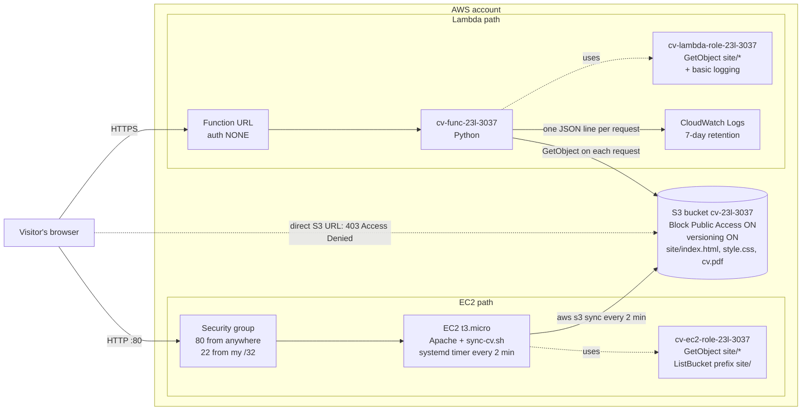

# CV on AWS - 23L-3037

My CV served twice from one private S3 bucket: by an Apache web server on EC2, and by a Lambda function URL.

| | Address |
|---|---|
| EC2 site | http://13.60.24.113/ |
| Lambda site | https://z47vj2helimcrxeealyhetrapm0hktfy.lambda-url.eu-north-1.on.aws/ |
| Bucket (private) | `cv-23l-3037` |

## Diagram



**EC2 path:** the browser sends an HTTP request on port 80 to the instance's public IP, the security group lets it in, and Apache returns files from `/var/www/html`, which `sync-cv.sh` copied from S3 (using the instance role) and stamped with the instance ID. **Lambda path:** the browser sends an HTTPS request to the function URL, AWS invokes the function, and the function reads the matching object from S3 with its execution role on every request, replaces the placeholder, and returns it.

## Access denied when writing from the instance

Run on the instance (`ssh ec2-user@13.60.24.113`):

```
[ec2-user@ip-172-31-45-5 ~]$ aws s3 rm s3://cv-23l-3037/site/style.css
delete failed: s3://cv-23l-3037/site/style.css An error occurred (AccessDenied) when calling the DeleteObject operation: User: arn:aws:sts::240715511257:assumed-role/cv-ec2-role-23l-3037/i-0c448962ca75cd03e is not authorized to perform: s3:DeleteObject on resource: "arn:aws:s3:::cv-23l-3037/site/style.css" because no identity-based policy allows the s3:DeleteObject action
[ec2-user@ip-172-31-45-5 ~]$ aws s3 cp /etc/hostname s3://cv-23l-3037/site/index.html
upload failed: ../../etc/hostname to s3://cv-23l-3037/site/index.html An error occurred (AccessDenied) when calling the PutObject operation: User: arn:aws:sts::240715511257:assumed-role/cv-ec2-role-23l-3037/i-0c448962ca75cd03e is not authorized to perform: s3:PutObject on resource: "arn:aws:s3:::cv-23l-3037/site/index.html" because no identity-based policy allows the s3:PutObject action
```

## Last 10 lines of /var/log/cv-sync.log

```
[ec2-user@ip-172-31-45-5 ~]$ sudo tail -n 10 /var/log/cv-sync.log
2026-10-24T16:34:02Z sync OK instance=i-0c448962ca75cd03e
2026-10-24T16:36:02Z sync OK instance=i-0c448962ca75cd03e
2026-10-24T16:38:02Z sync OK instance=i-0c448962ca75cd03e
2026-10-24T16:40:02Z sync OK instance=i-0c448962ca75cd03e
2026-10-24T16:42:02Z sync OK instance=i-0c448962ca75cd03e
2026-10-24T16:44:02Z sync OK instance=i-0c448962ca75cd03e
2026-10-24T16:46:02Z sync OK instance=i-0c448962ca75cd03e
2026-10-24T16:48:02Z sync OK instance=i-0c448962ca75cd03e
2026-10-24T16:50:01Z sync OK instance=i-0c448962ca75cd03e
2026-10-24T16:52:02Z sync OK instance=i-0c448962ca75cd03e
```

## Repository layout

```
README.md            this file
collect-evidence.sh  collects evidence.txt (run in CloudShell)
evidence.txt         output of my own run
site/                index.html, style.css, cv.pdf (uploaded to s3://cv-23l-3037/site/)
ec2/                 user-data.sh (first boot), sync-cv.sh (sync + footer + log)
lambda/              lambda_function.py
iam/                 trust and permission policies of both roles
```

## Written answers

**1. Why roles instead of access keys? What if keys were in the user data?**
- A role gives temporary credentials that AWS creates and renews by itself, so there is no secret to store or leak.
- User data is not secret: anyone who can view the instance settings, or any program on the instance, can read it.
- Leaked keys work from anywhere until someone turns them off, so an attacker could read or delete my data or run up a bill.
- Role credentials expire in a few hours and only allow what my policy says.

**2. Someone opens the S3 address of index.html in a browser. What do they see?**
- An `AccessDenied` error page (HTTP 403).
- The bucket is private: no bucket policy or ACL gives access to everyone, so S3 refuses anonymous requests.
- Block Public Access (all four settings on) makes sure nobody can make it public by mistake.

**3. The permission on the function URL that lets anyone call it.**
- With auth type NONE, the console added a resource-based policy to the function: principal `*` (anyone) may call it through the function URL.
- Anyone can *run* the function, but they only get what my code returns: three files or a 404.
- That is fine for the function because the code controls what is served. It is not fine for the bucket, because public read would expose every object directly with nothing in between.

**4. Compare the two paths: cost with no visitors, and 100x traffic.**
- EC2: I pay every hour it runs, even with zero visitors (instance, disk, public IP).
- Lambda: almost nothing with zero visitors; I only pay per request.
- 100x traffic: one small EC2 instance may slow down or crash, and I would have to add bigger or more servers myself.
- Lambda scales automatically by running more copies; the cost just grows with the traffic.

**5. You delete the EC2 instance. What do you lose and what do you keep?**
- Lose: the server, its disk (Apache, copied files, `/var/log/cv-sync.log`) and its public IP address.
- Keep: the S3 bucket and files, both IAM roles, the security group, the Lambda site and this repository.
- I can rebuild the EC2 site by launching a new instance with the same user data (it gets a new IP and instance ID).
